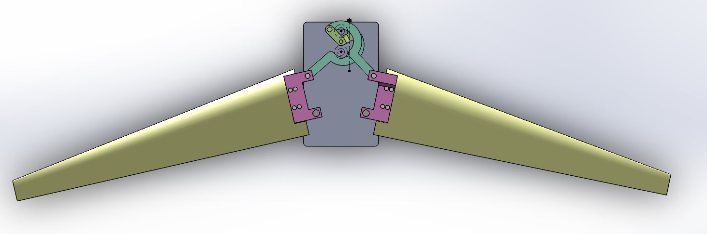
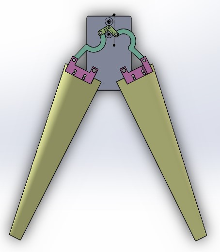

# Variable-Sweep-Wing Mechanism

**可变后掠翼机构｜机械设计 · MATLAB 运动学与动力学分析 · SolidWorks 运动仿真**

A variable-sweep-wing linkage mechanism with SolidWorks models, MATLAB analysis scripts, simulation results, and engineering documentation.

## 项目简介

本项目设计与分析一种**基于曲柄摇杆机构的可变后掠翼机械系统**。蜗轮蜗杆与齿轮轮系将旋转输入传递至中央曲柄，曲柄经左右连杆与翼根摇杆带动机翼展开或后掠。

仓库公开机械结构模型、MATLAB 分析程序、机构计算曲线、运动演示视频及技术文档，可用于机构原理学习、设计分析和后续开发。项目当前属于**机械设计与计算仿真阶段**，尚未完成实物或飞行验证。

**项目资源：** [三维模型](model/) · [MATLAB 源码](code/) · [计算结果](results/images/) · [运动视频](results/videos/) · [技术文档](documents/)

## 机构设计与运动原理

```text
蜗杆输入 → 蜗轮及齿轮轮系 → 中央曲柄
                                  ↓
                           左右连杆传动
                                  ↓
                        翼根摇杆带动机翼后掠
```

核心研究内容包括：

- **曲柄摇杆机构设计：** 连杆长度综合、输出摆角与压力角、传动角分析。
- **左右机构运动协调：** 曲柄相位、双侧摇杆角度、角速度及相对运动。
- **三维机构设计：** 机架、翼根连接件、连杆、曲柄与齿轮传动系统的 SolidWorks 建模。
- **动力学与载荷分析：** 运动副反力、单侧四杆机构动态静力计算与曲柄驱动力矩分析。

详细机械结构见 [机构设计报告](documents/01_mechanism_design.md)。

## 机构构型预览

| 完全展开状态 | 完全后掠状态 |
| :---: | :---: |
|  |  |

[中间状态图片](results/images/附录：中间状态.jpg) · [查看机构运动视频](results/videos/)

图像用于展示机械构型，不代表机翼后掠角已完成与设计目标的逐点标定。

## MATLAB 分析结果


仓库包含 **7 个分析入口、6 个辅助函数，共 13 个 MATLAB 文件**。主要分析程序与结果如下：

| 分析内容 | MATLAB 入口 | 结果 |
| --- | --- | --- |
| 连杆尺寸综合 | [design_link_lengths.m](code/design_link_lengths.m) | [计算记录](results/images/link_length_design.md) |
| 压力角与传动角 | [plot_pressure_transmission_angles.m](code/plot_pressure_transmission_angles.m) | [查看曲线](results/images/pressure_transmission_angles.jpg) |
| 双侧机构运动学 | [plot_linkage_kinematics.m](code/plot_linkage_kinematics.m) | [查看曲线](results/images/linkage_kinematics.jpg) |
| 连杆相对运动 | [plot_relative_linkage_kinematics.m](code/plot_relative_linkage_kinematics.m) | [查看曲线](results/images/relative_linkage_kinematics.jpg) |
| 双侧摇杆角度 | [plot_rocker_angle_response.m](code/plot_rocker_angle_response.m) | [查看曲线](results/images/dual_rocker_angles.jpg) |
| 简化运动反力 | [plot_joint_reaction.m](code/plot_joint_reaction.m) | [查看曲线](results/images/joint_reaction.jpg) |
| 动态静力分析 | [analyze_linkage_joint_forces.m](code/analyze_linkage_joint_forces.m) | [查看曲线](results/images/linkage_joint_forces.jpg) |

代码说明与计算条件见 [code/README.md](code/README.md) 和 [结果验证记录](results/images/VALIDATION_NOTES.md)。

## 项目目录

```text
variable_sweep_wing_mechanism/
├── README.md
├── LICENSE
├── model/
│   ├── README.md
│   └── 可变后掠翼机构.zip           # SolidWorks 模型压缩包
├── code/
│   ├── README.md
│   └── *.m                       # 7 个分析入口 + 6 个辅助函数
├── documents/
│   ├── README.md
│   ├── 01_mechanism_design.md
│   ├── 02_kinematics_analysis.md
│   ├── 03_dynamics_analysis.md
│   └── *.png                     # 受力分析示意图
└── results/
    ├── images/                   # 计算曲线、机构构型和说明
    └── videos/                   # 展开、后掠和传动演示
```

| 目录 | 提供内容 |
| --- | --- |
| [model/](model/) | SolidWorks 模型 ZIP：21 个零件、2 个装配体、1 个工程图 |
| [code/](code/) | 13 个 MATLAB 程序及运行说明 |
| [documents/](documents/) | 机构设计、运动学分析、动力学分析共 3 份技术报告 |
| [results/images/](results/images/) | 6 张 MATLAB 曲线、3 张机构构型图及计算记录 |
| [results/videos/](results/videos/) | 4 段机构与传动运动演示 |

## 快速开始

### 1. 获取仓库

```bash
git clone https://github.com/LittleMailman/variable_sweep_wing_mechanism.git
cd variable_sweep_wing_mechanism
```

### 2. 查看 SolidWorks 模型

1. 下载并解压 [可变后掠翼机构.zip](model/可变后掠翼机构.zip)。
2. 用兼容版本的 **SOLIDWORKS** 打开主装配体 `可变后掠翼机构.SLDASM`。
3. 检查零件引用、装配配合及干涉情况，再开展模型查看或运动分析。

**注意：** 仓库的 `model/` 目录存放的是 ZIP 文件；其中的 `.SLDPRT`、`.SLDASM`、`.SLDDRW` 文件需要解压后使用。参见 [模型说明](model/README.md)。

### 3. 运行 MATLAB

在 MATLAB 中将当前工作目录设置为仓库的 `code/`，即可分别运行以下脚本：

```matlab
clear; clc; close all;
design_link_lengths

close all;
plot_pressure_transmission_angles

close all;
plot_linkage_kinematics

close all;
plot_relative_linkage_kinematics

close all;
plot_rocker_angle_response

close all;
plot_joint_reaction

close all;
analyze_linkage_joint_forces
```

不同绘图程序之间建议执行 `close all`，以避免前一个程序的绘图状态影响后续图像。MATLAB 版本与工具箱的跨版本兼容性尚未系统验证。

### 4. 查看运动视频

在 [results/videos/](results/videos/) 中可查看机翼展开/后掠、齿轮传动及爆炸视图等演示。部分 AVI 视频可能无法在 GitHub 直接播放，可下载后使用本地播放器查看。

视频工况中的 **200 RPM 指蜗杆输入轴转速**，不是曲柄或机翼后掠角的转速。

## 设计参数

| 参数 | 数值 | 说明 |
| --- | --- | --- |
| 完全展开翼展 | 3 m | 总体设计目标 |
| 典型机翼后掠角 | 15°、45°、75° | 设计目标，待 CAD 逐点核对 |
| 曲柄长度 | 100.00 mm | 尺寸综合基准 |
| 连杆长度 | 385.65 mm | MATLAB 计算值 |
| 摇杆长度 | 230.19 mm | MATLAB 计算值 |
| 机架长度 | 457.76 mm | 尺寸综合值，部分程序采用 457.79 mm |
| 传动形式 | 蜗轮蜗杆与齿轮轮系 | 具体传动比待核对 |

MATLAB 运动学示例输入角速度为 100 rad/s，动态静力分析示例使用 10 rad/s；这些计算输入与蜗杆运动演示的 200 RPM **不是同一工况**。

## 技术文档

- [01 机构设计报告](documents/01_mechanism_design.md)：方案选型、机械结构和传动系统。
- [02 运动学分析报告](documents/02_kinematics_analysis.md)：尺寸综合、四杆模型、传动角及双侧运动。
- [03 动力学分析报告](documents/03_dynamics_analysis.md)：受力图、运动反力、动态静力分析与计算边界。

## 项目状态与验证范围

**已有成果：** SolidWorks 机械模型、运动演示、MATLAB 分析代码、计算图像及对应技术文档。

**仍需验证：** CAD 与 MATLAB 参数一致性、双侧运动关系、机构全行程干涉、实际齿轮传动比、质量及转动惯量、真实外载荷和驱动能力。当前反力与力矩曲线不能直接作为电机、轴承或结构强度的选型依据。

项目目前未完成实体样机制造、气动实验或飞行验证。欢迎通过 **Issues** 反馈问题，并通过 **Pull Requests** 提交改进。

## License

本项目使用 [MIT License](LICENSE)，版权信息以许可证文件为准。
