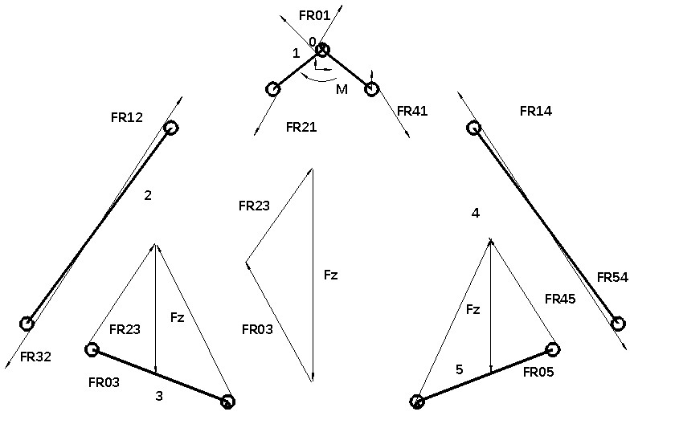
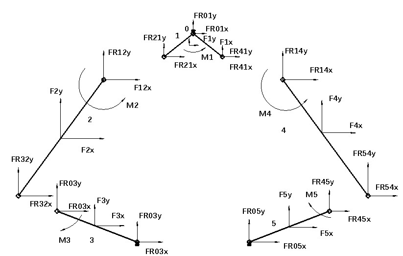
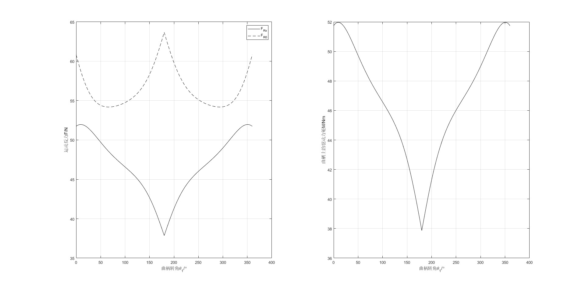
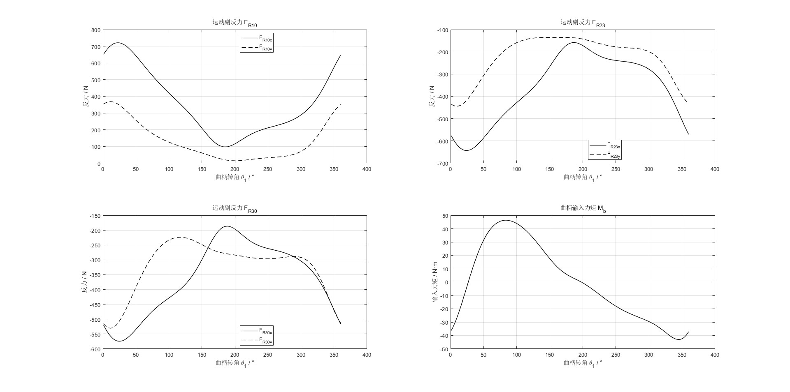

# 03 可变后掠翼机构动力学与运动反力分析报告

## 1. 分析范围与受力图

当前项目包含两类 MATLAB 力学分析：一类是基于摩擦圆和外载荷假设的**简化运动反力计算**；另一类是对**单侧四杆机构**进行动态静力分析，通过 9×9 方程求铰链反力与曲柄力矩。

### 双侧机构运动反力示意



### 各构件受力分解



图示涉及中央驱动构件及双侧连杆，而现有动态静力 MATLAB 程序主要计算**单侧简化四杆模型**。因此，不能直接把该求解结果理解为完整双侧机构的全部关节载荷或电机输入载荷。

## 2. 简化运动反力分析

简化反力模型根据运动副摩擦圆、连杆受力方向及给定外载荷建立几何关系，估算机构反力。对应 MATLAB 文件：

- [`plot_joint_reaction.m`](../code/plot_joint_reaction.m)：遍历曲柄角度并绘图；
- [`compute_joint_reaction.m`](../code/compute_joint_reaction.m)：计算简化反力的辅助函数。

示例设定采用无量纲杆长比 $x_1=1$、$x_2=3.86$、$x_3=2.30$、$x_4=4.58$，摩擦圆半径 $r=0.2$（与相对杆长一致），外载荷 $F_z=100\,\mathrm N$。



**单位提醒：** 当前简化模型的曲柄“力矩”绘图采用 $F_{Rx}x_1$，但 $x_1=1$ 是无量纲相对杆长；不能直接把图中数值当作真实的 N·m 力矩。应先换算实际长度，并复核摩擦圆假设、反力几何方向和力矩公式。

## 3. 单侧四杆机构动态静力分析

按达朗贝尔法，将杆件惯性力和惯性力偶写为：

```math
\mathbf F_{I,i}=-m_i\mathbf a_{G_i},\qquad
M_{I,i}=-J_{G_i}\alpha_i.
```

针对单侧三根运动杆件，分别列出水平方向、竖直方向和力矩平衡，由此组成 9 个线性方程：

```math
\mathbf A(\theta_1)\mathbf C=\mathbf B(\theta_1),
```

其中未知量可按当前代码排序为：

```math
\mathbf C=[M_b,F_{R10x},F_{R10y},F_{R12x},F_{R12y},
F_{R23x},F_{R23y},F_{R30x},F_{R30y}]^{\mathsf{T}}.
```

计算入口：[`analyze_linkage_joint_forces.m`](../code/analyze_linkage_joint_forces.m)。当前程序已将几何长度统一为米，并加入几何闭合与数值检查；动力学方程、装配分支及力平衡符号仍需进行独立力学验证。

### 示例参数

| 参数 | 当前计算示例 | 备注 |
| --- | ---: | --- |
| 曲柄角速度 | 10 rad/s | 匀速运动的计算工况 |
| 重力加速度 | 9.81 m/s² | SI 标准量纲 |
| 工作阻力矩 | 100 N·m | 给定计算载荷，非实测值 |
| 三杆质量 | 4.252、5.111、10.212 kg | 当前计算输入，待 CAD 核对 |
| 质心位置 | 各杆中点 | 简化假设 |

**转动惯量参数需要统一：** 一组设计参数记录的三杆惯量为 11168.8、83621.0、88665.0 kg·mm²，换算为 SI 单位应是 **0.0111688、0.083621、0.088665 kg·m²**；而当前 MATLAB 程序输入为 **0.111688、0.83621、0.88665 kg·m²**，为相应换算值的 **10 倍**。应重新核对 SolidWorks 质量属性和惯量参考轴，统一计算参数。

## 4. 动力学计算结果



在上述**当前脚本示例参数**下，绘图出现连续的运动副反力和力矩曲线。按已上传图像约读：

| 指标 | 图像中约读结果 | 说明 |
| --- | ---: | --- |
| $F_{R10}$ 最大分量绝对值 | 约 720 N | 单侧模型、示例参数 |
| $F_{R23}$ 最大分量绝对值 | 约 650 N | 同上 |
| $F_{R30}$ 最大分量绝对值 | 约 570 N | 同上 |
| 曲柄输入力矩 $M_b$ | 约 −43～46 N·m | 未校正惯量与真实载荷 |

这些计算曲线**不应作为当前机械机构选型所需载荷**，更不能据此直接决定电机、蜗轮蜗杆或轴承规格。需要使用实际质量、惯量、外载荷和传动效率重新计算。

## 5. 已完成与待验证工作

| 项目 | 当前状态 | 仍需开展的工作 |
| --- | --- | --- |
| MATLAB 运动学与动力学绘图 | 已生成曲线 | 物理模型及实验对比 |
| 单侧动力学长度量纲 | 已统一 m | 检查所有单位及符号 |
| 反余弦数值处理 | 已增加浮点定义域保护 | 各输入几何工况和奇异点测试 |
| 质量与转动惯量 | 已列出计算输入 | CAD 质量属性重新导出 |
| 蜗杆减速和轮系效率 | 已有初始齿数参数 | 齿数、传动比、效率核对 |
| 左右翼耦合动力学 | 未建立完整模型 | 汇总两侧负载与输入轴力矩 |
| 结构及实体实验 | 尚未完成 | 干涉、强度、锁紧、实物试验 |

**优先复核清单：**

1. 从 SolidWorks 获取每根运动杆件的质量、质心坐标与绕实际转轴的转动惯量，统一成 kg、m、kg·m²。
2. 明确真实气动力或等效翼根工作阻力矩的作用点、方向和大小。
3. 检查 9×9 方程中的转矩正方向、反力符号和运动学分支，测试静态或低速极限工况。
4. 以实际蜗轮蜗杆与齿轮级数计算输入轴的转速/力矩，建立完整双侧受力关系。
5. 形成 MATLAB 与 SolidWorks 运动研究的一致性记录，再更新报告中的示例数值。

> **验证范围：** 本文档提供现阶段的机构力学模型、计算工况和结果曲线。样机测试、动力系统选型验证及整机性能验收尚未完成。
