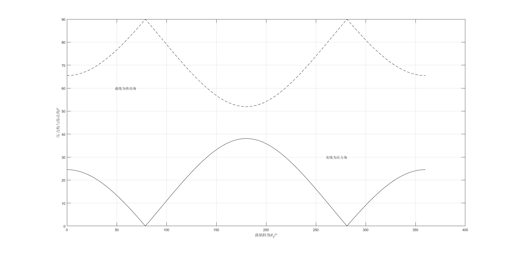
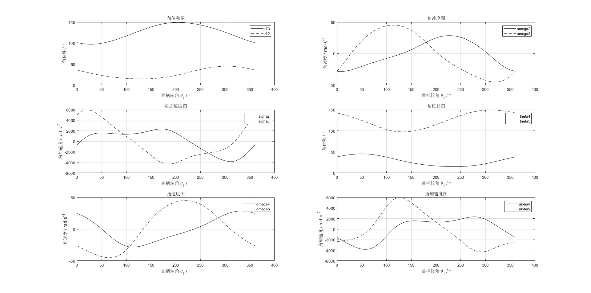
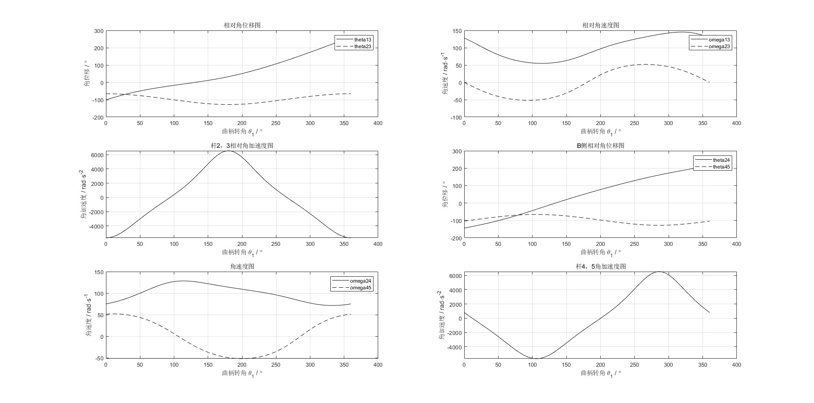
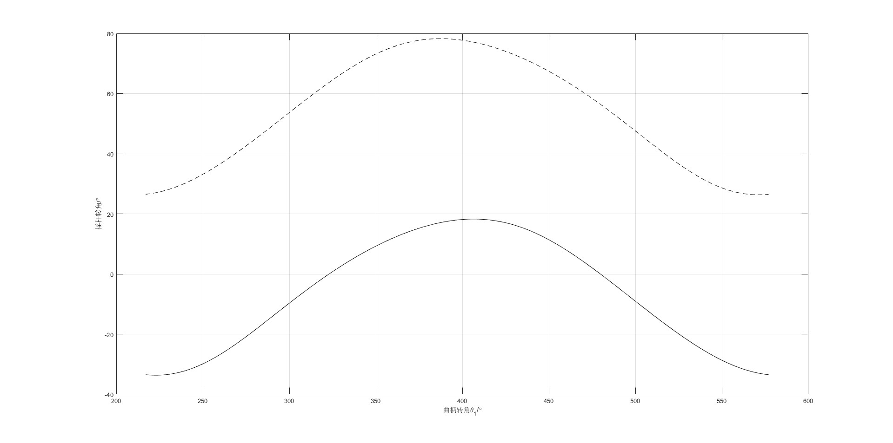

# MATLAB 计算与仿真结果

本目录保存可变后掠翼机构项目的 **MATLAB 分析结果（示例工况）**。目前包含 6 张已生成的计算曲线图和 1 份连杆尺寸综合数值记录，对应 `code/matlab/` 中的 7 个主程序。

**结果状态：已完成 MATLAB 基本运行和可视化检查，尚未完成与 SolidWorks 运动研究、实物参数及独立动力学模型的工程一致性验证。** 所有结果为历史示例参数的输出，不应直接用于电机选型或承载设计。

## 结果索引

| 结果文件 | 内容 | 对应程序 |
|---|---|---|
| [`link_length_design.md`](./link_length_design.md) | 尺寸综合与杆长计算（文字结果） | `design_link_lengths.m` |
| [`pressure_transmission_angles.jpg`](./pressure_transmission_angles.jpg) | 压力角、传动角与曲柄转角关系 | `plot_pressure_transmission_angles.m` |
| [`linkage_kinematics.jpg`](./linkage_kinematics.jpg) | 双侧连杆角位移、角速度与角加速度 | `plot_linkage_kinematics.m` |
| [`relative_linkage_kinematics.jpg`](./relative_linkage_kinematics.jpg) | 双侧机构相对运动 | `plot_relative_linkage_kinematics.m` |
| [`dual_rocker_angles.jpg`](./dual_rocker_angles.jpg) | 106° 曲柄偏置下的两侧摇杆响应 | `plot_rocker_angle_response.m` |
| [`joint_reaction.jpg`](./joint_reaction.jpg) | 简化案例反力与力矩表达式输出 | `plot_joint_reaction.m` |
| [`linkage_joint_forces.jpg`](./linkage_joint_forces.jpg) | 9×9 平面力学平衡的铰接反力和曲柄力矩 | `analyze_linkage_joint_forces.m` |

## 1. 连杆尺寸综合

见 [连杆尺寸计算结果](./link_length_design.md)。基准曲柄长度 100 mm；示例计算连杆约 385.65 mm、摇杆约 230.19 mm、机架约 457.76 mm。

## 2. 压力角与传动角

从图中估读，最小传动角约 52°、最大压力角约 38°。该结果仅代表当前参数和计算公式下的角度变化，尚未转化为传动性能验收指标。

## 3. 双侧机构运动学

显示杆 2～5 的角位移、角速度和角加速度，原脚本输入曲柄角速度为 `100 rad/s`，故角加速度峰值较大。两侧运动的角度基准与方向需进一步用 SolidWorks 核实。

## 4. 连杆相对运动

包含相对角位移、角速度和角加速度；曲柄整周旋转对应的相对角位移可以包含累积角度，不应直接用图首尾角度不同判断失败。

## 5. 两侧摇杆角度

第一侧采用单层平方根公式重新计算后的结果。曲线读数（近似）：第一侧约 −34°～18°、第二侧约 26°～78°。这些量是**摇杆角度**，尚不能直接解释为机翼实际后掠角。

## 6. 简化运动反力

图中左侧反力约为几十牛，右侧标为 N·m 的曲线仍来自无量纲 `x1 = 1` 的旧公式，其数值**不是实际 N·m 驱动力矩**。具体单位限制见 [`code/README.md`](../code/README.md)。

## 7. 动力学与铰链反力

程序已将杆长改用米，图中反力分量最大绝对值约 `720 N`，输入力矩约 `−43～46 N·m`（读图近似）。这些数据依赖未核实的示例质量、转动惯量和工作阻力矩，**不得直接作为实际驱动器选型依据**。

有关目前通过的检查与后续需要补齐的工程验证，见 [验证记录](./VALIDATION_NOTES.md)。
